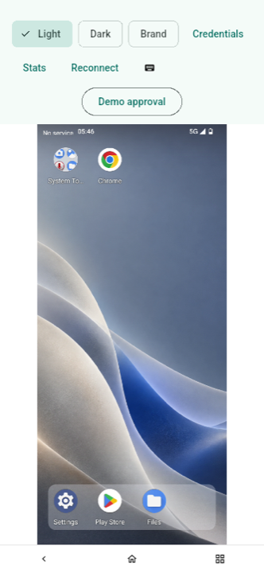

<p align="center">
  <picture>
    <source media="(prefers-color-scheme: dark)" srcset="assets/mobilerun-dark.png" />
    <source media="(prefers-color-scheme: light)" srcset="assets/mobilerun.png" />
    
  </picture>
</p>

<h1 align="center">mobilerun-flutter</h1>

<p align="center">
  <strong>Embed Mobilerun device streaming and remote input in your Flutter app.</strong><br />
  Live WebRTC video, touch and keyboard control, task approvals and optional UI for Android and iOS.
</p>

<div align="center">

<a href="https://docs.mobilerun.ai/partners">🤝 Partner guide</a>
·
<a href="https://docs.mobilerun.ai">📕 Documentation</a>
·
<a href="https://cloud.mobilerun.ai">☁️ Mobilerun Cloud</a>


[](./LICENSE)
[](https://discord.gg/ZZbKEZZkwK)

[React](https://github.com/droidrun/mobilerun-react) · [Android](https://github.com/droidrun/mobilerun-android) · [iOS](https://github.com/droidrun/mobilerun-swift) · **Flutter**

</div>

> **Building Mobilerun phones into your platform?** Start with the [Partner guide](https://docs.mobilerun.ai/partners). It walks through the API key, one phone per user, stream tokens and live viewing step by step.

<table>
<tr>
<td width="280" valign="top">

</td>
<td valign="top">
<strong>In this package</strong>
<ul>
<li><code>DeviceStreamSession</code> — connection, recovery and screenshots.</li>
<li><code>DeviceStream</code> — video with status overlays and navigation.</li>
<li><code>DeviceStreamView</code> — video and input for your own UI.</li>
<li><code>DeviceStreamController</code> — keyboard and system-key controls.</li>
<li><code>StreamCredentials</code> — stream target and token provider.</li>
<li><code>StreamLifecycle</code> — app visibility and network recovery.</li>
<li><code>TaskApprovalController</code> — approval fetching and decisions.</li>
<li><code>TaskApprovalCard</code> — approval details and action buttons.</li>
<li><code>StreamTheme</code> and labels — styling and localization.</li>
<li><code>StreamStats</code> — connection and video statistics.</li>
</ul>
<strong>Requirements</strong>
<ul>
<li>Android API 24+ or iOS 13+; the example targets iOS 15+.</li>
<li>Flutter 3.47.9+ with Dart 3.13.7+.</li>
<li>A Mobilerun API key on your server.</li>
</ul>
</td>
</tr>
</table>

## Install

The package is not published yet; install from source until the first release.
Its API may still change.

```sh
flutter pub add mobilerun_flutter --git-url https://github.com/droidrun/mobilerun-flutter.git
```

After the first release, add `mobilerun_flutter: ^0.1.0` to your dependencies.
The host Android app needs `<uses-permission android:name="android.permission.INTERNET" />`
in `android/app/src/main/AndroidManifest.xml`, including release builds. Set
`uses-material-design: true` under `flutter:` in the host's `pubspec.yaml` for the default UI icons.

## Quick start

1. Your server mints a short-lived stream token for one device with your API key
   (`POST /v1/identity/stream-keys`). Follow the [Partner guide](https://docs.mobilerun.ai/partners).
2. Your app's `tokenProvider` asks your server for a stream token before each connection.
3. The SDK opens the stream with that stream token, one token per connection, and reconnects with a fresh one.

On your server, mint with `MOBILERUN_API_KEY` (never ship it in the app).
Authenticate your user and check they own the device first:

```js
// POST https://api.mobilerun.ai/v1/identity/stream-keys
const res = await fetch('https://api.mobilerun.ai/v1/identity/stream-keys', {
  method: 'POST',
  headers: {
    Authorization: `Bearer ${process.env.MOBILERUN_API_KEY}`,
    'Content-Type': 'application/json',
  },
  body: JSON.stringify({ deviceId, ttlSeconds: 120 }),
});
const { key, keyId, expiresAt } = await res.json();
// Return only `key` to your app.
```

The stream-token mint route and DTO currently retain their transitional names
`/identity/stream-keys` and `{key,keyId,expiresAt}`.

In your app, using your backend client and the device's stream URL:

```dart
final session = DeviceStreamSession(
  credentials: () async => StreamCredentials(
    url: streamUrl,
    // Called before every connection, including each reconnect.
    tokenProvider: () => backend.mintStreamToken(deviceId),
  ),
  onError: (error) =>
      debugPrint('stream ${error.reason.code} attempt ${error.attempt}'),
)..start();
// Inside a bounded area, such as Expanded:
DeviceStream(
  session: session,
  labels: const StreamLabels(unavailable: 'Phone offline', retry: 'Try again'),
);
// Close the session when finished: await session.close();
```

`onError` reasons are `credentials_unavailable`, `connection_refused`,
`token_rejected` (HTTP 401 on connect), `disconnected` and `unknown`;
`isFinal` is true once the SDK stops retrying. 

**Credential modes.** `tokenProvider` is the recommended path: one fresh stream token per
connection. The static `StreamCredentials.token` is a **device token (legacy)**, deprecated until its
hard cut. It is an explicit exception: a reconnect **reuses the same static token**
(the SDK logs one deprecation warning per session). That works for a long-lived
token, but a single-use stream token is rejected on the second connect, so single-use
stream tokens need `tokenProvider`.

## Guides

| Guide | Covers |
| --- | --- |
| [Stream tokens](doc/stream-tokens.md) | Single-use stream tokens, deadlines, retries, `onError` reasons and legacy credentials. |
| [Video and input](doc/video-and-input.md) | Touch, keyboard, host back, URLs and screenshots. |
| [Default UI](doc/default-ui.md) | Navigation, overlays, custom builders, themes and labels. |
| [Task approvals](doc/task-approvals.md) | Backend callbacks, polling, decisions and card customization. |
| [Session and lifecycle](doc/lifecycle.md) | Status, codecs, credentials, visibility and network recovery. |
| [Statistics](doc/stats.md) | Stats fields, sampling and the benchmark procedure. |

## Contributing

<a id="development"></a>

See [CONTRIBUTING.md](CONTRIBUTING.md) for building, tests, conformance fixtures, the example app and releases.
Report vulnerabilities privately through [SECURITY.md](SECURITY.md).

## License

[Apache-2.0](LICENSE).
